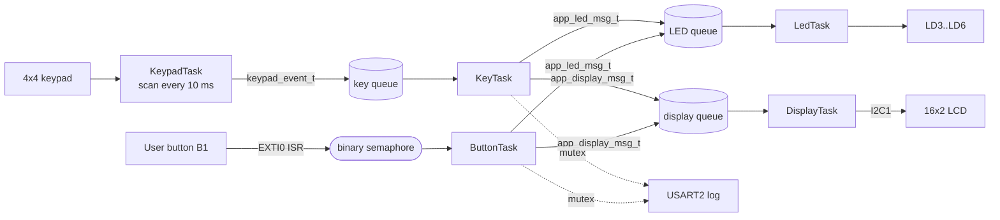

# STM32F411 FreeRTOS Keypad and LCD Demo

A small FreeRTOS project for the **STM32F411E-DISCO** (32F411EDISCOVERY, MB1115) that reads a
**4x4 key matrix** with a reusable keypad library, shows the key events on a **16x2 I2C LCD** with
a reusable LCD library and drives the four on-board LEDs.
It combines the building blocks from the RTOS course in one project: tasks, queues with a message
struct, a binary semaphore given from an interrupt, a mutex for a shared resource (UART) and
task-switch tracing for a logic analyser.



## Status

| What | State |
|---|---|
| Keypad library logic (debounce, hold, repeat, multi-key) | Unit-tested on the PC (`tests/host`) |
| LCD library (init sequence, text, positioning, control) | Unit-tested on the PC against a simulated HD44780 behind a PCF8574 |
| Complete firmware | Compiles and links for the STM32F411VE with arm-none-eabi-gcc against ST's HAL and FreeRTOS 10.3.1 |
| Running on the real board | **Not tested yet** |
| `.ioc` file | **Written by hand, not yet opened in STM32CubeMX.** If it does not load, follow the manual steps in [docs/cubemx-setup.md](docs/cubemx-setup.md) |

## What it does

| Input | Action |
|---|---|
| Keys `1` `2` `3` `4` | Toggle the green / orange / red / blue LED |
| Key `A` | All LEDs on |
| Key `B` | All LEDs off |
| Key `D` | Running light: one step per press, auto-repeat while held |
| Any key | Shown in the second LCD row and logged on USART2, e.g. `Key 5 PRESS`, `Key 5 HOLD`, `Key 5 RELEASE` |
| Blue user button B1 | Toggle all LEDs (interrupt + semaphore), `Button B1` on the LCD |

The LCD is optional. Without it the rest works the same, and the log says `LCD not found`.

## Hardware

- STM32F411E-DISCO board (STM32F411VET6)
- 4x4 matrix keypad with 8-pin header, 8 jumper wires
- 16x2 character LCD (HD44780) with PCF8574 I2C backpack, 4 jumper wires
- Optional: 8-channel logic analyser, USB-UART adapter (3.3 V) for the log output

### Wiring

Keypad pins counted from left to right with the keys facing you. Most 4x4 keypads use pins 1-4
for the rows and 5-8 for the columns. **Check yours with a multimeter**: pressing key `1` must
connect row 1 and column 1.

| Keypad pin | Signal | STM32 pin | CubeMX setting |
|---|---|---|---|
| 1 | Row 1 (`1 2 3 A`) | PD0 | Output open-drain, initially high |
| 2 | Row 2 (`4 5 6 B`) | PD1 | Output open-drain, initially high |
| 3 | Row 3 (`7 8 9 C`) | PD2 | Output open-drain, initially high |
| 4 | Row 4 (`* 0 # D`) | PD3 | Output open-drain, initially high |
| 5 | Column 1 | PE7 | Input, pull-up |
| 6 | Column 2 | PE8 | Input, pull-up |
| 7 | Column 3 | PE9 | Input, pull-up |
| 8 | Column 4 | PE10 | Input, pull-up |

No external resistors are needed. The internal pull-ups are used.

### LCD wiring

| Backpack pin | STM32F411E-DISCO |
|---|---|
| GND | GND |
| VCC | 5V |
| SDA | PB7 (I2C1_SDA) |
| SCL | PB8 (I2C1_SCL) |

- The display needs 5 V. The pull-up resistors on the backpack then pull SDA and SCL to 5 V,
  which is the reason for PB7/PB8: both are 5 V tolerant, and unlike PB6/PB9 they are not
  connected to the I2C bus of the on-board audio chip and accelerometer.
- The I2C address is found automatically (usually `0x27`, or `0x3F` with a PCF8574A).
- If the backlight is on but no text is visible, turn the **contrast potentiometer** on the
  backpack. This is the most common "it does not work".

| Other signal | STM32 pin |
|---|---|
| LEDs green / orange / red / blue (on board) | PD12 / PD13 / PD14 / PD15 |
| User button B1 (on board) | PA0 |
| Task trace 1..4 for the logic analyser | PE11 / PE12 / PE13 / PE14 |
| USART2 TX / RX, 115200 8N1 | PA2 / PA3 |

### Logic analyser

Connect CH1..CH4 to PE11..PE14 and GND to GND. A trace pin is high while its task is running:

| Channel | Pin | Task |
|---|---|---|
| CH1 | PE11 | KeypadTask (a short pulse every 10 ms) |
| CH2 | PE12 | KeyTask |
| CH3 | PE13 | LedTask |
| CH4 | PE14 | ButtonTask |

With the remaining channels on PD0..PD3 you can watch the row scan: one row after the other is
pulled low. PA2 can be decoded as UART (115200 baud).

## Repository structure

```
.
├── stm32f411-freertos-keypad.ioc   STM32CubeMX configuration
├── Core
│   ├── Inc
│   │   ├── keypad.h                keypad library: core (HAL only, no RTOS)
│   │   ├── keypad_rtos.h           keypad library: FreeRTOS wrapper (scan task + queue)
│   │   ├── lcd_i2c.h               LCD library: HD44780 with PCF8574 I2C backpack
│   │   ├── app.h                   application: message types, App_Init()
│   │   ├── mytrace.h               task-switch trace for the logic analyser
│   │   ├── FreeRTOSConfig.h        CubeMX file, trace hooks in the USER CODE sections
│   │   └── main.h, stm32f4xx_*.h   CubeMX files
│   └── Src
│       ├── keypad.c, keypad_rtos.c
│       ├── lcd_i2c.c
│       ├── app.c                   all tasks, queues, semaphore, mutex, EXTI callback
│       ├── mytrace.c
│       ├── main.c                  CubeMX file, calls App_Init() in a USER CODE section
│       └── stm32f4xx_*.c, system_stm32f4xx.c   CubeMX files
├── docs
│   ├── cubemx-setup.md             CubeMX settings step by step, with and without the .ioc
│   ├── architecture.md             tasks, queues, priorities, timing
│   ├── keypad-library.md           how to use the keypad library in other projects
│   └── lcd-library.md              how to use the LCD library in other projects
└── tests/host                      PC unit tests for both libraries (mock HAL)
```

`Drivers/` and `Middlewares/` (HAL, CMSIS, FreeRTOS), the startup file, the linker script and the
STM32CubeIDE project files are **not** in this repository yet. STM32CubeMX creates them on the
first *Generate Code*. Commit them afterwards so that the repository builds on its own.

The application code is kept out of `main.c` on purpose: CubeMX can regenerate `main.c` at any
time, and only two lines there belong to the application (`#include "app.h"` and `App_Init();`).

## Getting started

1. Clone the repository.
2. Open `stm32f411-freertos-keypad.ioc` in STM32CubeMX and click **GENERATE CODE**, or create the
   configuration by hand. Both ways are described in
   [docs/cubemx-setup.md](docs/cubemx-setup.md).
3. Import the folder into STM32CubeIDE (*File > Import > Existing Projects into Workspace*),
   build and flash.
4. Wire the keypad and the LCD as shown above and press keys.

## Using the keypad library elsewhere

Copy `keypad.c/.h` (and `keypad_rtos.c/.h` for FreeRTOS) into another CubeMX project:

```c
static const keypad_pin_t rows[4] = { {GPIOD, GPIO_PIN_0}, {GPIOD, GPIO_PIN_1},
                                      {GPIOD, GPIO_PIN_2}, {GPIOD, GPIO_PIN_3} };
static const keypad_pin_t cols[4] = { {GPIOE, GPIO_PIN_7}, {GPIOE, GPIO_PIN_8},
                                      {GPIOE, GPIO_PIN_9}, {GPIOE, GPIO_PIN_10} };
static const keypad_config_t cfg = {
    .rows = rows, .num_rows = 4, .cols = cols, .num_cols = 4,
    .keymap = KEYPAD_KEYMAP_4X4,
    .debounce_ms = 20, .hold_ms = 800, .repeat_ms = 200,
    .configure_gpio = true, .settle_loops = 50,
};
static keypad_rtos_t keypad;

/* before the scheduler starts */
keypad_rtos_start(&keypad, &cfg, NULL, 10, 10, tskIDLE_PRIORITY + 3, 128);

/* in any task */
char key = keypad_rtos_wait_key(&keypad, portMAX_DELAY);
```

Details, the event API and the version without RTOS: [docs/keypad-library.md](docs/keypad-library.md).

## Using the LCD library elsewhere

Copy `lcd_i2c.c/.h` into another CubeMX project that has an I2C peripheral enabled:

```c
static lcd_i2c_t lcd;

lcd_i2c_config_t cfg = { .hi2c = &hi2c1, .cols = 16, .rows = 2 };
cfg.address = lcd_i2c_find(&hi2c1);          /* or fixed: 0x27 */

if (lcd_init(&lcd, &cfg) == LCD_OK) {
    lcd_write_line(&lcd, 0, "Hello");        /* whole row, padded with spaces */
    lcd_print_at(&lcd, 4, 1, "world");       /* column 4, second row */
}
```

Details and the use with FreeRTOS (display task with a queue): [docs/lcd-library.md](docs/lcd-library.md).

## Tests

The logic of both libraries can be tested on a PC without the board:

```
make -C tests/host
```

## Third-party code

The files that STM32CubeMX generates (`main.c`, `stm32f4xx_*.c/.h`, `system_stm32f4xx.c`,
`FreeRTOSConfig.h`) are based on templates by STMicroelectronics and keep their licence terms.
