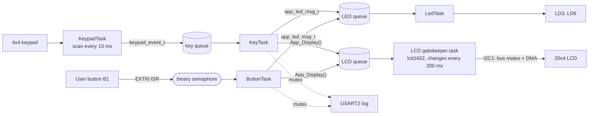

# STM32F411 FreeRTOS Keypad and LCD Demo

A small FreeRTOS project for the **STM32F411E-DISCO** (32F411EDISCOVERY, MB1115) that reads a
**4x4 key matrix** with a reusable keypad library, shows the key events on a **20x4 I2C LCD**
(HD44780 behind a PCF8574T) and drives the four on-board LEDs.
It combines the building blocks from the RTOS course in one project: tasks, queues with a message
struct, a binary semaphore given from an interrupt, mutexes for shared resources (UART, I2C bus),
DMA with a semaphore from the "transfer complete" interrupt, a gatekeeper task for the display and
task-switch tracing for a logic analyser.



## Status

| What | State |
|---|---|
| Keypad library logic (debounce, hold, repeat, multi-key) | Unit-tested on the PC (`tests/host`) |
| LCD driver `lcd1602` (20x4, gatekeeper task, I2C bus mutex, DMA, timing diagram) | Unit-tested on the PC against a simulated HD44780 behind a PCF8574, with mocked FreeRTOS and DMA interrupt |
| Older LCD library `lcd_i2c` (blocking, no RTOS) | Unit-tested on the PC; no longer used by the application |
| Complete firmware | Compiles and links for the STM32F411VE with arm-none-eabi-gcc against ST's HAL and FreeRTOS 10.3.1 |
| Running on the real board | Keypad, LEDs and the 20x4 LCD with `lcd1602` (behind the level shifter) work. Tested with blocking I2C, because the DMA channel is not set up yet (next row) |
| `.ioc` file | Opened in STM32CubeMX and generated. The DMA channel for I2C1 is **not added yet**; until then the LCD driver uses blocking I2C (see [docs/cubemx-setup.md](docs/cubemx-setup.md), B6) |

## What it does

| Input | Action |
|---|---|
| Keys `1` `2` `3` `4` | Toggle the green / orange / red / blue LED |
| Key `A` | All LEDs on |
| Key `B` | All LEDs off |
| Key `D` | Running light: one step per press, auto-repeat while held |
| Any key | Shown in the second LCD row and logged on USART2, e.g. `Key 5 PRESS`, `Key 5 HOLD`, `Key 5 RELEASE` |
| Blue user button B1 | Toggle all LEDs (interrupt + semaphore), `Button B1` on the LCD |

The fourth LCD row shows `I2C: DMA` or `I2C: blocking`, i.e. whether the LCD driver could use DMA.

The LCD is optional. Without it the rest works the same, and the log says `LCD not found`. When
the display answers, the log says `LCD found, I2C with DMA`, or why it falls back to blocking I2C,
e.g. `LCD found, I2C blocking: no DMA channel for I2C TX`.

## Hardware

- STM32F411E-DISCO board (STM32F411VET6)
- 4x4 matrix keypad with 8-pin header, 8 jumper wires
- 20x4 character LCD TC2004A-01 (HD44780) with PCF8574T I2C module
- Bidirectional level shifter 3.3 V / 5 V (at least 2 channels), jumper wires
- Optional: 8-channel logic analyser, USB-UART adapter (3.3 V) for the log output

### Wiring

**How to count the keypad pins:** hold the keypad with the keys facing you so that the `*` key is
in the **bottom left corner**. Pin 1 is the **leftmost** pin of the 8-pin header from this view,
pin 8 the rightmost.

```
 ┌───┬───┬───┬───┐
 │ 1 │ 2 │ 3 │ A │   row 1
 ├───┼───┼───┼───┤
 │ 4 │ 5 │ 6 │ B │   row 2
 ├───┼───┼───┼───┤
 │ 7 │ 8 │ 9 │ C │   row 3
 ├───┼───┼───┼───┤
 │ * │ 0 │ # │ D │   row 4
 └───┴───┴───┴───┘
  col1 col2 col3 col4

   pin 1 2 3 4 5 6 7 8
       │ │ │ │ │ │ │ │
       └─cols┘ └─rows┘
```

On the tested keypad, pins 1-4 are the **columns** and pins 5-8 the **rows**:

| Keypad pin | Signal | STM32 pin | CubeMX setting |
|---|---|---|---|
| 1 | Column 1 (`1 4 7 *`) | PE7 | Input, pull-up |
| 2 | Column 2 (`2 5 8 0`) | PE8 | Input, pull-up |
| 3 | Column 3 (`3 6 9 #`) | PE9 | Input, pull-up |
| 4 | Column 4 (`A B C D`) | PE10 | Input, pull-up |
| 5 | Row 1 (`1 2 3 A`) | PD0 | Output open-drain, initially high |
| 6 | Row 2 (`4 5 6 B`) | PD1 | Output open-drain, initially high |
| 7 | Row 3 (`7 8 9 C`) | PD2 | Output open-drain, initially high |
| 8 | Row 4 (`* 0 # D`) | PD3 | Output open-drain, initially high |

No external resistors are needed. The internal pull-ups are used.

Not all keypads use this order. **Check yours with a multimeter** (pressing key `1` must connect
row 1 and column 1), or test it: if key `2` acts like `4` and `*` acts like `A` (all LEDs on),
rows and columns are swapped. Then swap the two groups of four wires and keep the order within
each group.

### LCD wiring

The display runs on 5 V, the STM32 on 3 V. A level shifter sits between the two I2C lines:

| STM32F411E-DISCO | Level shifter | I2C module of the LCD |
|---|---|---|
| 3V | LV | |
| 5V | HV | VCC |
| GND | GND (both sides, if it has two GND pins) | GND |
| PB7 (I2C1_SDA) | LV1 ↔ HV1 | SDA |
| PB8 (I2C1_SCL) | LV2 ↔ HV2 | SCL |

- **All grounds must be connected**: STM32, level shifter and display. Without GND the level
  shifter does not work.
- Every pin marked `3V` on the headers P1/P2 is the same supply, any of them works for LV. Any
  `GND` pin works as well.
- This project uses **PB7/PB8**, not PB6/PB9 as on the lecture slides: on the STM32F411E-DISCO,
  PB6/PB9 are the I2C bus of the on-board audio chip and accelerometer. PB7 and PB8 are 5 V
  tolerant, so the display would also work without the level shifter.
- The I2C address is set in `lcd1602.h`: `0x27` for the PCF8574T, `0x3F` for a PCF8574AT.
- If the backlight is on but no text is visible, turn the **contrast potentiometer** on the
  module. This is the most common "it does not work".
- Why the level shifter is needed and how it works: [docs/lcd1602-library.md](docs/lcd1602-library.md#2-wiring-with-the-level-shifter-pegelwandler).

| Other signal | STM32 pin |
|---|---|
| LEDs green / orange / red / blue (on board) | PD12 / PD13 / PD14 / PD15 |
| User button B1 (on board) | PA0 |
| Task trace 1..4 for the logic analyser | PE11 / PE12 / PE13 / PE14 |
| USART2 TX / RX, 115200 8N1 | PA2 / PA3 |

### Logic analyser

Connect CH1..CH4 to PE11..PE14 and GND to GND. A trace pin is high while its task is running:

| Channel | Pin | Task |
|---|---|---|
| CH1 | PE11 | KeypadTask (a short pulse every 10 ms) |
| CH2 | PE12 | KeyTask |
| CH3 | PE13 | LedTask |
| CH4 | PE14 | ButtonTask |

With the remaining channels on PD0..PD3 you can watch the row scan: one row after the other is
pulled low. PA2 can be decoded as UART (115200 baud).

## Repository structure

```
.
├── stm32f411-freertos-keypad.ioc   STM32CubeMX configuration
├── Core
│   ├── Inc
│   │   ├── keypad.h                keypad library: core (HAL only, no RTOS)
│   │   ├── keypad_rtos.h           keypad library: FreeRTOS wrapper (scan task + queue)
│   │   ├── lcd1602.h               LCD driver used by the app: 20x4, gatekeeper task, I2C mutex, DMA
│   │   ├── lcd_i2c.h               older LCD library (blocking, no RTOS), not used by the app
│   │   ├── app.h                   application: message types, App_Init()
│   │   ├── mytrace.h               task-switch trace for the logic analyser
│   │   ├── FreeRTOSConfig.h        CubeMX file, trace hooks in the USER CODE sections
│   │   └── main.h, stm32f4xx_*.h   CubeMX files
│   └── Src
│       ├── keypad.c, keypad_rtos.c
│       ├── lcd1602.c, lcd_i2c.c
│       ├── app.c                   all tasks, queues, semaphore, mutex, EXTI callback
│       ├── mytrace.c
│       ├── main.c                  CubeMX file, calls App_Init() in a USER CODE section
│       └── stm32f4xx_*.c, system_stm32f4xx.c   CubeMX files
├── docs
│   ├── cubemx-setup.md             CubeMX settings step by step, with and without the .ioc
│   ├── architecture.md             tasks, queues, priorities, timing
│   ├── keypad-library.md           how to use the keypad library in other projects
│   ├── lcd1602-library.md          LCD driver lcd1602: level shifter wiring, concepts, API
│   ├── present-lcd-code.md         notes for presenting the LCD code
│   └── lcd-library.md              older LCD library lcd_i2c
└── tests/host                      PC unit tests for the libraries (mock HAL, mock FreeRTOS)
```

`Drivers/` and `Middlewares/` (HAL, CMSIS, FreeRTOS), the startup file, the linker script and the
STM32CubeIDE project files were created by STM32CubeMX (*Generate Code*) and are committed, so the
repository builds on its own.

The application code is kept out of `main.c` on purpose: CubeMX can regenerate `main.c` at any
time, and only two lines there belong to the application (`#include "app.h"` and `App_Init();`).

## Getting started

1. Clone the repository.
2. Open `stm32f411-freertos-keypad.ioc` in STM32CubeMX and click **GENERATE CODE**, or create the
   configuration by hand. Both ways are described in
   [docs/cubemx-setup.md](docs/cubemx-setup.md).
3. Import the folder into STM32CubeIDE (*File > Import > Existing Projects into Workspace*),
   build and flash.
4. Wire the keypad and the LCD as shown above and press keys.

## Build and run

The project is an STM32CubeIDE project (no CMake). It is built with the GCC toolchain that comes
with STM32CubeIDE and flashed over the ST-LINK on the board (mini-USB connector) with OpenOCD.

| Tool | Used for |
|---|---|
| STM32CubeIDE | Build (also headless, without opening the IDE) and its GCC toolchain |
| OpenOCD (`brew install open-ocd`) | Flash and debug over the on-board ST-LINK |
| VS Code with *Cortex-Debug* (optional) | Editing, flashing and debugging with breakpoints |

### In STM32CubeIDE

*File > Import > Existing Projects into Workspace*, select this folder, then *Project > Build
Project* and *Run > Run As > STM32 C/C++ Application*.

### From the command line or VS Code (macOS)

**1. Full build.** Runs STM32CubeIDE without a window and creates the makefiles and the firmware
`Debug/stm32f411-freertos-keypad.elf`. Needed once, and again after adding or removing source
files:

```bash
/Applications/STM32CubeIDE.app/Contents/MacOS/STM32CubeIDE --launcher.suppressErrors -nosplash \
  -application org.eclipse.cdt.managedbuilder.core.headlessbuild \
  -data "$HOME/.stm32cubeide-headless-ws" -import "$PWD" -build stm32f411-freertos-keypad/Debug
```

**2. Fast rebuild.** After the first full build, `make` in `Debug/` is enough. Put the
STM32CubeIDE toolchain first in `PATH`, because other `arm-none-eabi-gcc` installations (for
example Homebrew's) may be a different version or lack `arm-none-eabi-size` and the linker:

```bash
PATH="$(ls -d /Applications/STM32CubeIDE.app/Contents/Eclipse/plugins/*gnu-tools-for-stm32*/tools/bin | tail -1):$PATH" \
  make -C Debug -j8 all
```

**3. Flash.** Connect the board with the mini-USB cable (ST-LINK) and run:

```bash
openocd -f board/stm32f4discovery.cfg \
  -c "program {$PWD/Debug/stm32f411-freertos-keypad.elf} verify reset exit"
```

The firmware starts right after the reset. `Error: open failed` means that OpenOCD does not find
the ST-LINK: check the USB cable (it must be the mini-USB connector, not the micro-USB one).

**4. Debug (VS Code).** With the *Cortex-Debug* extension, a launch configuration with
`"servertype": "openocd"`, `"configFiles": ["board/stm32f4discovery.cfg"]`, `"rtos": "FreeRTOS"`
and `"gdbPath"` pointing to `arm-none-eabi-gdb` in the STM32CubeIDE toolchain folder from step 2
stops at `main()` and shows the FreeRTOS tasks. The commands above can be added as VS Code tasks
(`.vscode/` is not in the repository).

### Seeing the output

- Keys `1`..`4` toggle the LEDs: the quickest check that the keypad wiring is right.
- The UART log (USART2, PA2/PA3, 115200 8N1) is **not** routed through the ST-LINK USB cable on
  this board. Connect a 3.3 V USB-UART adapter (adapter RX to PA2, TX to PA3, GND to GND) and open
  it with a serial terminal, for example the VS Code *Serial Monitor* or
  `screen /dev/tty.usbserial-* 115200`.

## Using the keypad library elsewhere

Copy `keypad.c/.h` (and `keypad_rtos.c/.h` for FreeRTOS) into another CubeMX project:

```c
static const keypad_pin_t rows[4] = { {GPIOD, GPIO_PIN_0}, {GPIOD, GPIO_PIN_1},
                                      {GPIOD, GPIO_PIN_2}, {GPIOD, GPIO_PIN_3} };
static const keypad_pin_t cols[4] = { {GPIOE, GPIO_PIN_7}, {GPIOE, GPIO_PIN_8},
                                      {GPIOE, GPIO_PIN_9}, {GPIOE, GPIO_PIN_10} };
static const keypad_config_t cfg = {
    .rows = rows, .num_rows = 4, .cols = cols, .num_cols = 4,
    .keymap = KEYPAD_KEYMAP_4X4,
    .debounce_ms = 20, .hold_ms = 800, .repeat_ms = 200,
    .configure_gpio = true, .settle_loops = 50,
};
static keypad_rtos_t keypad;

/* before the scheduler starts */
keypad_rtos_start(&keypad, &cfg, NULL, 10, 10, tskIDLE_PRIORITY + 3, 128);

/* in any task */
char key = keypad_rtos_wait_key(&keypad, portMAX_DELAY);
```

Details, the event API and the version without RTOS: [docs/keypad-library.md](docs/keypad-library.md).

## Using the LCD driver elsewhere

`lcd1602.c/.h` (used by this application) needs FreeRTOS and an I2C peripheral. Copy both files
into the other project and adapt only section 1 of `lcd1602.h` (I2C handle, address, display size):

```c
/* before the scheduler starts */
lcd1602_start(NULL);                         /* NULL = the driver creates the I2C bus mutex */

/* in any task - returns at once, the gatekeeper task writes the display */
lcd1602_write_line(0, "Hello");              /* whole row, padded with spaces */
lcd1602_print(1, 4, "world");                /* column 4, second row */
```

For DMA, add the I2C TX DMA channel and the I2C event/error interrupts in CubeMX, see the comment
at the top of `lcd1602.h`. Without them the driver works with blocking I2C.
Wiring, background and API: [docs/lcd1602-library.md](docs/lcd1602-library.md); notes for
presenting the code: [docs/present-lcd-code.md](docs/present-lcd-code.md).

The older `lcd_i2c.c/.h` needs no RTOS, but it waits for every transfer. Copy it into another
CubeMX project that has an I2C peripheral enabled:

```c
static lcd_i2c_t lcd;

lcd_i2c_config_t cfg = { .hi2c = &hi2c1, .cols = 16, .rows = 2 };
cfg.address = lcd_i2c_find(&hi2c1);          /* or fixed: 0x27 */

if (lcd_init(&lcd, &cfg) == LCD_OK) {
    lcd_write_line(&lcd, 0, "Hello");        /* whole row, padded with spaces */
    lcd_print_at(&lcd, 4, 1, "world");       /* column 4, second row */
}
```

Details and the use with FreeRTOS (display task with a queue): [docs/lcd-library.md](docs/lcd-library.md).

## Tests

The logic of the libraries (keypad, `lcd1602`, `lcd_i2c`) can be tested on a PC without the board.
The LCD tests feed every I2C byte into a simulated HD44780; for `lcd1602` the simulator also
checks the timing diagram (RS valid before E rises, data held when E falls):

```
make -C tests/host
```

## Third-party code

The files that STM32CubeMX generates (`main.c`, `stm32f4xx_*.c/.h`, `system_stm32f4xx.c`,
`FreeRTOSConfig.h`) are based on templates by STMicroelectronics and keep their licence terms.
