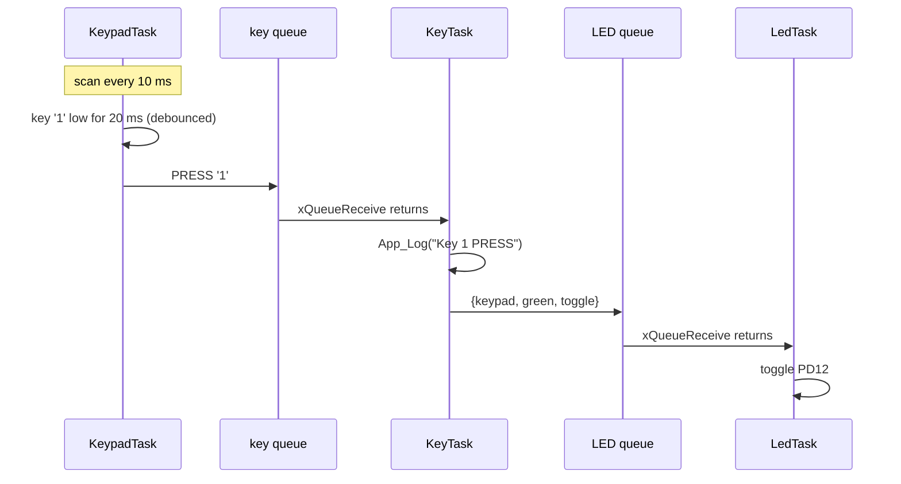

# Architecture

## Tasks

| Task | Created in | Priority | Stack (words) | Trace tag / pin | Job |
|---|---|---|---|---|---|
| KeypadTask | `keypad_rtos_start()` | idle + 3 | 128 | 1 / PE11 | Scans the matrix every 10 ms, debounces, sends `keypad_event_t` to the key queue |
| KeyTask | `App_Init()` | idle + 2 | 256 | 2 / PE12 | Waits for key events, logs them, translates them into LED messages |
| LedTask | `App_Init()` | idle + 2 | 128 | 3 / PE13 | The only task that touches the LEDs, executes LED messages |
| ButtonTask | `App_Init()` | idle + 2 | 128 | 4 / PE14 | Waits for the semaphore from the button interrupt |
| DisplayTask | `App_Init()` | idle + 1 | 256 | none | The only task that talks to the LCD (display manager), writes the texts from the display queue |
| defaultTask | CubeMX (`main.c`) | osPriorityNormal | 128 | none | Unused, only sleeps |

The keypad task has the highest application priority so that the scan period stays exact
(`vTaskDelayUntil`). It runs only for a few microseconds per scan.

## Communication objects

| Object | Type | Written by | Read by |
|---|---|---|---|
| key queue | queue, 10 x `keypad_event_t` | KeypadTask | KeyTask |
| LED queue | queue, 10 x `app_led_msg_t` | KeyTask, ButtonTask | LedTask |
| display queue | queue, 8 x `app_display_msg_t` | KeyTask, ButtonTask via `App_Display()` | DisplayTask |
| button semaphore | binary semaphore | `HAL_GPIO_EXTI_Callback` (ISR) | ButtonTask |
| UART mutex | mutex | KeyTask, ButtonTask via `App_Log()` | |

The LED message is the struct from the course whiteboard: the sender ID, the LED and the action.

```c
typedef struct {
    uint8_t sender;   /* 1 = keypad, 2 = button        */
    uint8_t led;      /* 0..3 or APP_LED_ALL           */
    uint8_t action;   /* off, on, toggle               */
} app_led_msg_t;
```

Queues copy the message, so the sender can use a local variable.

The display message carries the row and the text:

```c
typedef struct {
    uint8_t row;                      /* 0 = top row            */
    char    text[APP_LCD_COLS + 1];   /* zero-terminated text   */
} app_display_msg_t;
```

Writing one LCD row takes about 8 ms on the I2C bus at 100 kHz. Because of the queue, no other
task waits for that: `App_Display()` returns at once, and the DisplayTask runs at the lowest
application priority. If the queue is full, the new text is dropped.

The DisplayTask looks for the display at start-up (`lcd_i2c_find`). Without a display it tries
again every 2 seconds and the rest of the application runs normally.

## Sequence of a key press



## Interrupts

| Interrupt | Priority | Use |
|---|---|---|
| EXTI0 (PA0, user button) | 5 | Gives the button semaphore with `xSemaphoreGiveFromISR` |
| TIM11 | 15 | HAL time base (`HAL_GetTick`), because FreeRTOS owns the SysTick |
| SysTick, PendSV | 15 | FreeRTOS tick and context switch |

An interrupt that calls FreeRTOS `...FromISR` functions must have a priority number of 5 or higher
(`configLIBRARY_MAX_SYSCALL_INTERRUPT_PRIORITY`). A lower number means a higher priority, and such
an interrupt must not call the FreeRTOS API.

## Task-switch trace

`FreeRTOSConfig.h` maps the kernel hooks `traceTASK_SWITCHED_IN` and `traceTASK_SWITCHED_OUT` to
`Trace_TaskSwitchedIn/Out()` in `mytrace.c`. Each task gets a tag with
`vTaskSetApplicationTaskTag()`. The pin that belongs to the tag is high while the task runs.
Tasks without a tag (idle, timer, defaultTask) are not traced.

## Memory

FreeRTOS heap: 15360 bytes (`configTOTAL_HEAP_SIZE`, heap_4). The application needs roughly 6.5 kB
of it for its task stacks, queues and semaphores. If `App_Init()` cannot create an object, it
calls `Error_Handler()`.
