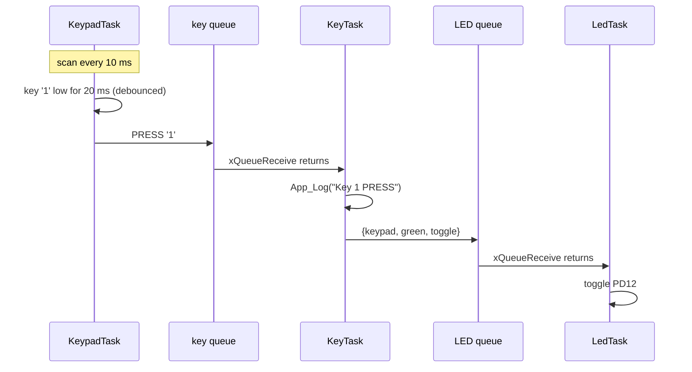

# Architecture

## Tasks

| Task | Created in | Priority | Stack (words) | Trace tag / pin | Job |
|---|---|---|---|---|---|
| KeypadTask | `keypad_rtos_start()` | idle + 3 | 128 | 1 / PE11 | Scans the matrix every 10 ms, debounces, sends `keypad_event_t` to the key queue |
| KeyTask | `App_Init()` | idle + 2 | 256 | 2 / PE12 | Waits for key events, logs them, translates them into LED messages |
| LedTask | `App_Init()` | idle + 2 | 128 | 3 / PE13 | The only task that touches the LEDs, executes LED messages |
| ButtonTask | `App_Init()` | idle + 2 | 128 | 4 / PE14 | Waits for the semaphore from the button interrupt |
| LCD (gatekeeper) | `lcd1602_start()` | idle + 1 | 256 (static) | none | The only task that talks to the LCD: applies the messages from the LCD queue to a frame buffer and sends the changed characters every 200 ms |
| defaultTask | CubeMX (`main.c`) | osPriorityNormal | 128 | none | Unused, only sleeps |

The keypad task has the highest application priority so that the scan period stays exact
(`vTaskDelayUntil`). It runs only for a few microseconds per scan.

## Communication objects

| Object | Type | Written by | Read by |
|---|---|---|---|
| key queue | queue, 10 x `keypad_event_t` | KeypadTask | KeyTask |
| LED queue | queue, 10 x `app_led_msg_t` | KeyTask, ButtonTask | LedTask |
| LCD queue | queue, 8 x 24-byte message (inside `lcd1602.c`) | KeyTask, ButtonTask via `App_Display()` | LCD gatekeeper task |
| I2C bus mutex | mutex (inside `lcd1602.c`, shareable) | LCD gatekeeper task, around every I2C transfer | |
| I2C "done" semaphore | binary semaphore (inside `lcd1602.c`) | I2C/DMA interrupt (`HAL_I2C_MasterTxCpltCallback`) | LCD gatekeeper task |
| button semaphore | binary semaphore | `HAL_GPIO_EXTI_Callback` (ISR) | ButtonTask |
| UART mutex | mutex | KeyTask, ButtonTask via `App_Log()` | |

The LED message is the struct from the course whiteboard: the sender ID, the LED and the action.

```c
typedef struct {
    uint8_t sender;   /* 1 = keypad, 2 = button        */
    uint8_t led;      /* 0..3 or APP_LED_ALL           */
    uint8_t action;   /* off, on, toggle               */
} app_led_msg_t;
```

Queues copy the message, so the sender can use a local variable.

## LCD driver (`lcd1602`)

The display is written by the gatekeeper task of the `lcd1602` driver (lecture MCP21, slides
26-29). `App_Display(row, text)` calls `lcd1602_write_line()`, which only copies the text into the
LCD queue with timeout 0 and returns at once. If the queue is full, the text is dropped.

The gatekeeper task keeps two buffers of 4 x 20 characters: the frame (what should be shown) and
what is on the glass. It applies every message to the frame, and every 200 ms it sends only the
characters that changed: per row the range from the first to the last changed column, together
with the cursor command, in one I2C transfer.

| Transfer | PCF8574 bytes | Time on the bus at 100 kHz |
|---|---|---|
| One character | 5 (one per step of the timing diagram) | about 0.45 ms |
| One changed character incl. cursor command | 10 | about 1 ms |
| One whole row incl. cursor command | 105 | about 9.5 ms |

Every transfer runs like this (slide 28): take the I2C bus mutex, start the DMA transfer, block on
the "done" semaphore (the CPU runs the other tasks meanwhile), the I2C interrupt gives the semaphore
when the last byte is out, release the mutex. If the DMA channel or the I2C interrupts are not set
up in CubeMX, the driver uses the blocking `HAL_I2C_Master_Transmit()` instead; then only the
gatekeeper task waits.

The gatekeeper task initialises the display itself (power-up delay and init sequence with
`vTaskDelay`). Without a display it tries again every 2 seconds and the rest of the application
runs normally; texts sent in the meantime are kept in the frame and appear as soon as the display
answers. The driver reports "found" / "not found" through `lcd1602_ready_changed()`, which `app.c`
uses for the log message.

## Sequence of a key press



## Interrupts

| Interrupt | Priority | Use |
|---|---|---|
| EXTI0 (PA0, user button) | 5 | Gives the button semaphore with `xSemaphoreGiveFromISR` |
| I2C1 event, I2C1 error, DMA1 stream 6 | 5 | I2C transfer with DMA for the LCD; the "transfer complete" callback gives the semaphore of the LCD driver. Only after the DMA is added in CubeMX |
| TIM11 | 15 | HAL time base (`HAL_GetTick`), because FreeRTOS owns the SysTick |
| SysTick, PendSV | 15 | FreeRTOS tick and context switch |

An interrupt that calls FreeRTOS `...FromISR` functions must have a priority number of 5 or higher
(`configLIBRARY_MAX_SYSCALL_INTERRUPT_PRIORITY`). A lower number means a higher priority, and such
an interrupt must not call the FreeRTOS API.

## Task-switch trace

`FreeRTOSConfig.h` maps the kernel hooks `traceTASK_SWITCHED_IN` and `traceTASK_SWITCHED_OUT` to
`Trace_TaskSwitchedIn/Out()` in `mytrace.c`. Each task gets a tag with
`vTaskSetApplicationTaskTag()`. The pin that belongs to the tag is high while the task runs.
Tasks without a tag (idle, timer, defaultTask) are not traced.

## Memory

FreeRTOS heap: 15360 bytes (`configTOTAL_HEAP_SIZE`, heap_4). The application needs roughly 5 kB
of it for its task stacks, queues and semaphores. The LCD driver does not use the heap: its task,
queue and semaphores are allocated statically (about 1.8 kB in `.bss`). If `App_Init()` cannot
create an object, it calls `Error_Handler()`.
