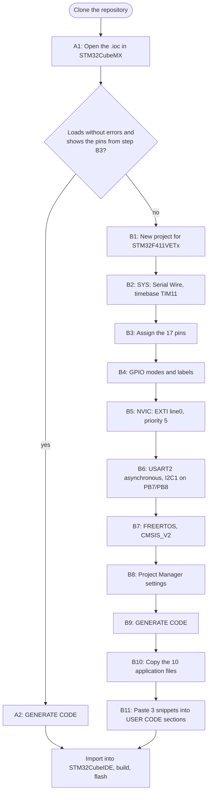

# STM32CubeMX setup

Two ways lead to the same project. Try A first. B always works and is also the reference for every
setting that the `.ioc` contains.



> The `.ioc` in this repository was written by hand and has not been opened in STM32CubeMX yet.
> It declares an old CubeMX version on purpose, so a current CubeMX offers to migrate it.

## A: With the `.ioc` file

**A1.** Start STM32CubeMX (the standalone tool) and open `stm32f411-freertos-keypad.ioc`.
- If CubeMX says the project was created with an older version, choose **Migrate**.
- If it asks to download the STM32CubeF4 firmware package, accept.

Then compare what you see with the tables in B2 to B8, at least the pinout view (23 configured pins: the 17 from B3 plus PA2, PA3, PA13, PA14, PB7, PB8)
and *Middleware > FREERTOS* (enabled, CMSIS_V2). If something is missing, set it by hand as
described in B, or switch to way B completely.

**A2.** Click **GENERATE CODE**. CubeMX adds `Drivers/`, `Middlewares/`, the startup file, the
linker script and the STM32CubeIDE project files (`.project`, `.cproject`) to the repository
folder. Existing files in `Core/` are regenerated, and everything between `USER CODE BEGIN` and
`USER CODE END` is kept.

After generating, check that these three places still contain the application code. If one is
empty, paste it again from step B11:

| File | Section | Content |
|---|---|---|
| `Core/Src/main.c` | `USER CODE BEGIN Includes` | `#include "app.h"` |
| `Core/Src/main.c` | `USER CODE BEGIN RTOS_THREADS` | `App_Init();` |
| `Core/Inc/FreeRTOSConfig.h` | `USER CODE BEGIN Includes` and `USER CODE BEGIN Defines` | `mytrace.h` include and trace macros |

Continue with [Import, build, flash](#import-build-flash).

## B: By hand

### B1. New project

STM32CubeMX: *File > New Project* (STM32CubeIDE with built-in CubeMX: *File > New > STM32 Project*).
In the **MCU/MPU Selector** search for `STM32F411VE` and pick **STM32F411VETx** (LQFP100).

Using the MCU instead of the board selector keeps the pinout empty, so only the pins of this
project are configured.

### B2. System Core > SYS

| Setting | Value | Why |
|---|---|---|
| Debug | Serial Wire | Keeps PA13/PA14 for the ST-LINK |
| Timebase Source | **TIM11** | FreeRTOS uses the SysTick, the HAL needs another timer. The STM32F411 has no TIM6/TIM7, TIM11 is a simple timer without a use in this project |

*System Core > RCC* stays untouched. The project runs on the internal 16 MHz oscillator (HSI),
which is the default in the *Clock Configuration* tab.

### B3. Pinout view: assign the pins

Click each pin in the chip view and choose the function:

| Pins | Function |
|---|---|
| PD0, PD1, PD2, PD3 | GPIO_Output |
| PE7, PE8, PE9, PE10 | GPIO_Input |
| PE11, PE12, PE13, PE14 | GPIO_Output |
| PD12, PD13, PD14, PD15 | GPIO_Output |
| PA0 | GPIO_EXTI0 |

PA2, PA3, PB7 and PB8 follow in step B6, PA13 and PA14 were set by step B2.

### B4. System Core > GPIO: modes and labels

Select each pin in the table and set the fields below. **The user labels must match exactly**,
because the code uses the names that CubeMX derives from them (`KP_ROW1_Pin`,
`KP_ROW1_GPIO_Port`, ...).

| Pin | User label | GPIO mode | Output level | Pull-up/Pull-down | Max. output speed |
|---|---|---|---|---|---|
| PD0 | `KP_ROW1` | Output **Open Drain** | **High** | No pull | Low |
| PD1 | `KP_ROW2` | Output Open Drain | High | No pull | Low |
| PD2 | `KP_ROW3` | Output Open Drain | High | No pull | Low |
| PD3 | `KP_ROW4` | Output Open Drain | High | No pull | Low |
| PE7 | `KP_COL1` | Input mode | | **Pull-up** | |
| PE8 | `KP_COL2` | Input mode | | Pull-up | |
| PE9 | `KP_COL3` | Input mode | | Pull-up | |
| PE10 | `KP_COL4` | Input mode | | Pull-up | |
| PE11 | `TRACE_1` | Output Push Pull | Low | No pull | High |
| PE12 | `TRACE_2` | Output Push Pull | Low | No pull | High |
| PE13 | `TRACE_3` | Output Push Pull | Low | No pull | High |
| PE14 | `TRACE_4` | Output Push Pull | Low | No pull | High |
| PD12 | `LED_GREEN` | Output Push Pull | Low | No pull | Low |
| PD13 | `LED_ORANGE` | Output Push Pull | Low | No pull | Low |
| PD14 | `LED_RED` | Output Push Pull | Low | No pull | Low |
| PD15 | `LED_BLUE` | Output Push Pull | Low | No pull | Low |
| PA0 | `BTN_USER` | External Interrupt Mode with **Rising** edge trigger detection | | No pull | |

### B5. System Core > NVIC

| Interrupt | Enabled | Preemption priority |
|---|---|---|
| EXTI line0 interrupt | **yes** | **5** |

The interrupt gives a semaphore with `xSemaphoreGiveFromISR`. That is only allowed for priority
numbers of 5 or higher. Do this step after B7 if CubeMX does not let you choose the priority yet.

### B6. Connectivity > USART2 and I2C1

**USART2**

| Setting | Value |
|---|---|
| Mode | Asynchronous |
| Hardware Flow Control | Disable |
| Baud Rate | 115200 Bits/s |
| Word Length / Parity / Stop Bits | 8 Bits / None / 1 |

CubeMX assigns PA2 (TX) and PA3 (RX). The log output is optional. Without a USB-UART adapter the
project works the same.

**I2C1** (for the LCD)

| Setting | Value |
|---|---|
| I2C | I2C |
| I2C Speed Mode | Standard Mode |
| I2C Clock Speed | 100000 Hz |

CubeMX first puts I2C1 on its default pins. **Move SCL to PB8**: click PB8 in the chip view and
choose `I2C1_SCL`. SDA must be on PB7. The result:

| Pin | Function |
|---|---|
| PB7 | I2C1_SDA |
| PB8 | I2C1_SCL |

PB6 must not be used: on this board PB6 and PB9 are the I2C bus of the on-board audio chip and
accelerometer, which should not see the 5 V pull-ups of the LCD backpack.

### B7. Middleware > FREERTOS

| Setting | Value |
|---|---|
| Interface | **CMSIS_V2** |
| Config parameters > TOTAL_HEAP_SIZE | 15360 (default) |
| Config parameters > USE_APPLICATION_TASK_TAG | Enabled, if your CubeMX version lists it. `FreeRTOSConfig.h` also sets it in a USER CODE section, so the project works either way |
| Tasks and Queues | Leave the `defaultTask` as it is |

Everything else stays at the default (preemption on, 1000 Hz tick, mutexes on, heap_4).
The application creates its tasks, queues, semaphore and mutex itself in `app.c`, so nothing has
to be added in the *Tasks and Queues* or *Timers and Semaphores* tabs.

### B8. Project Manager

| Tab | Setting | Value |
|---|---|---|
| Project | Project Name | `stm32f411-freertos-keypad` |
| Project | Toolchain / IDE | STM32CubeIDE, *Generate Under Root* checked |
| Code Generator | STM32Cube MCU packages | Copy only the necessary library files |
| Code Generator | Generated files | *Keep User Code when re-generating* checked, *Generate peripheral initialization as a pair of .c/.h files* **not** checked |

### B9. Generate

Click **GENERATE CODE**. If CubeMX warns about newlib reentrancy with FreeRTOS, you can continue:
the application does not call `printf` or `malloc` from tasks.

### B10. Copy the application files

Copy these files from this repository into the new project. Do not copy the other files in
`Core/`, CubeMX has just generated its own versions of them.

| To `Core/Inc` | To `Core/Src` |
|---|---|
| `keypad.h` | `keypad.c` |
| `keypad_rtos.h` | `keypad_rtos.c` |
| `app.h` | `app.c` |
| `mytrace.h` | `mytrace.c` |
| `lcd_i2c.h` | `lcd_i2c.c` |

### B11. Paste three snippets

`Core/Src/main.c`:

```c
/* USER CODE BEGIN Includes */
#include "app.h"
/* USER CODE END Includes */
```

```c
  /* USER CODE BEGIN RTOS_THREADS */
  /* add threads, ... */
  App_Init();
  /* USER CODE END RTOS_THREADS */
```

`Core/Inc/FreeRTOSConfig.h`:

```c
/* USER CODE BEGIN Includes */
/* Section where include file can be added */
#include "mytrace.h"
/* USER CODE END Includes */
```

```c
/* USER CODE BEGIN Defines */
/* Section where parameter definitions can be added (for instance, to override default ones in FreeRTOS.h) */
#undef  configUSE_APPLICATION_TASK_TAG
#define configUSE_APPLICATION_TASK_TAG 1

#define traceTASK_SWITCHED_IN()  Trace_TaskSwitchedIn( (int)pxCurrentTCB->pxTaskTag )
#define traceTASK_SWITCHED_OUT() Trace_TaskSwitchedOut( (int)pxCurrentTCB->pxTaskTag )
/* USER CODE END Defines */
```

## Import, build, flash

1. STM32CubeIDE: *File > Import > General > Existing Projects into Workspace*, select the project
   folder. Skip this if you created the project inside STM32CubeIDE.
2. *Project > Build Project*. It must finish with 0 errors.
3. Connect the board with the mini-USB cable (ST-LINK side) and start *Run > Debug*.
4. Press key `1`: the green LED toggles.

## Check list if something does not work

| Symptom | Look at |
|---|---|
| `KP_ROW1_Pin` (or similar) undeclared | A user label from B4 is missing or spelled differently |
| `App_Init` undefined | `app.c` is not in `Core/Src`, or the include in `main.c` is missing |
| `pxTaskTag` is not a member | `configUSE_APPLICATION_TASK_TAG` is not 1, see the Defines snippet in B11 |
| Nothing happens, debugger stops in `Error_Handler` | An RTOS object could not be created: check TOTAL_HEAP_SIZE |
| Program hangs when the blue button is pressed | EXTI0 priority is below 5, see B5 |
| No key is detected | Rows and columns swapped or keypad pinout different: check with a multimeter. Columns must have pull-ups |
| A whole row or column is dead | One jumper wire is loose or on the wrong pin |
| HAL timeouts never end | Timebase source is not TIM11, see B2 |
| `hi2c1` undeclared or `I2C_HandleTypeDef` unknown | I2C1 is not enabled, see B6 |
| Log says `LCD not found` | Wiring (SDA = PB7, SCL = PB8, VCC = 5V, GND), or SCL was left on PB6 |
| Backlight on, but no text | Turn the contrast potentiometer on the backpack |
