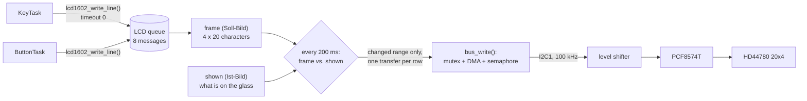
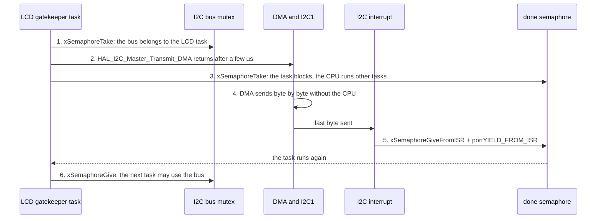

# LCD driver `lcd1602`: 20x4 I2C display with FreeRTOS

Driver for the 20x4 character LCD **TC2004A-01** (HD44780 controller) with a **PCF8574T** I2C
module, for FreeRTOS on the **STM32F411E-DISCO**. It was built from the provided library
`LCD1602.c/.h` (Golinskiy, German translation by H. Paulis) following the lecture
*LCD-Display* (MCP21, 17.11.2026, slides 21-31).

- Code: [`Core/Inc/lcd1602.h`](../Core/Inc/lcd1602.h), [`Core/Src/lcd1602.c`](../Core/Src/lcd1602.c)
- Test: [`tests/host/test_lcd1602.c`](../tests/host/test_lcd1602.c)
- Notes for presenting the code: [present-lcd-code.md](present-lcd-code.md)

| Property | How the driver does it |
|---|---|
| The calling task never waits | Messages go into a queue with timeout 0 |
| No mixed-up text from several tasks ("Zeichensalat") | Only one gatekeeper task writes to the display |
| Little load on the I2C bus | Frame buffer: every 200 ms only the changed characters are sent |
| CPU free during a transfer | DMA, and a semaphore given by the "transfer complete" interrupt |
| I2C bus shared with other devices | Mutex around every transfer; other drivers can use the same mutex |
| HD44780 timing diagram is met | 5 PCF8574 bytes per character, one per step of the diagram |
| Display missing or unplugged | Detected, retried every 2 s, the content comes back by itself |
| Portable | Hardware-specific code only in section 1 of the header and in the port section |

## 1. Hardware

| Part | Notes |
|---|---|
| STM32F411E-DISCO (MB1115) | I2C1 on **PB7 (SDA)** and **PB8 (SCL)**, 3 V logic |
| LCD TC2004A-01, 20 x 4 characters | HD44780-compatible controller, supply 5 V |
| I2C module with PCF8574T, soldered to the LCD | Address `0x27`, contrast trimmer, backlight jumper, 4.7 kΩ pull-ups to 5 V |
| Bidirectional level shifter (Pegelwandler), e.g. 4 channels with BSS138 MOSFETs | 2 channels are used: SDA and SCL |
| 7 jumper wires | |

## 2. Wiring with the level shifter (Pegelwandler)

The STM32 works with 3 V, the LCD module with 5 V. The level shifter connects the two I2C lines
and translates the voltage in both directions.

```
STM32F411E-DISCO            Level shifter                I2C module (PCF8574T)
(3 V logic)                 LV side  |  HV side          on the LCD (5 V)

3V   ────────────────────── LV       |
5V   ────────────────────────────────┼─── HV ─────────── VCC
GND  ────────────────────── GND      |    GND ────────── GND
PB7 (I2C1_SDA) ──────────── LV1 <─────────> HV1 ──────── SDA
PB8 (I2C1_SCL) ──────────── LV2 <─────────> HV2 ──────── SCL
```

| Signal | STM32F411E-DISCO | Level shifter, LV side | Level shifter, HV side | I2C module |
|---|---|---|---|---|
| 3 V reference | `3V` | LV | | |
| 5 V supply | `5V` | | HV | VCC |
| Ground | `GND` | GND | GND | GND |
| I2C data | PB7 (I2C1_SDA) | LV1 | HV1 | SDA |
| I2C clock | PB8 (I2C1_SCL) | LV2 | HV2 | SCL |

### Checklist before switching on

1. **Connect all grounds**: STM32, level shifter and LCD module. Many level shifters have one GND
   pin per side; they are connected inside, but wiring both does no harm. Without a common GND
   the level shifter has no reference and the log says `LCD not found`.
2. **LV goes to 3V, HV goes to 5V.** LV must be the supply voltage of the STM32 (the `3V` pin,
   about 3 V on this board), HV the supply voltage of the module (5 V).
3. **Any `3V`, `5V` or `GND` pin** on the headers P1/P2 works: pins with the same label are the
   same net.
4. **SDA and SCL each stay on one channel**: PB7 on LV1 means SDA on HV1, PB8 on LV2 means SCL on
   HV2. Which channel numbers you use does not matter.
5. **PB7 and PB8, not PB6/PB9** as on slides 23/25. On the STM32F411E-DISCO, PB6/PB9 are the I2C
   bus of the on-board audio chip (CS43L22) and accelerometer (LSM303DLHC). This project
   configures I2C1 on PB7/PB8 in CubeMX. With the level shifter PB6/PB9 would be electrically
   fine too, but then the CubeMX configuration must be changed.
6. **No extra resistors.** The module has 4.7 kΩ pull-ups to 5 V on the HV side, the level shifter
   has its own pull-ups (usually 10 kΩ) on both sides, and CubeMX enables the internal pull-ups of
   PB7/PB8. All of them together are fine for 100 kHz.
7. **Backlight jumper** on the module must be closed, otherwise bit P3 cannot switch the light.
8. **Contrast trimmer** on the module: if the backlight is on but no text is visible, turn it.

### Why a level shifter?

- The LCD needs 5 V. With 3.3 V the voltage across the liquid crystal is too low and the contrast
  is poor (slide 25: "Modul an 5 V betreiben"). So the PCF8574 also runs at 5 V.
- A PCF8574 at 5 V detects a logic high only from **0.7 × VDD = 3.5 V** (slide 25). A bus pulled
  up to 3.3 V is outside its specification.
- The level shifter gives each side its own levels: the STM32 never sees more than 3 V, the
  PCF8574 sees full 5 V levels.
- Without the level shifter it also works on PB7/PB8, because these pins are **5 V tolerant (FT)**
  and I2C is open-drain: the module's pull-ups pull the lines to 5 V, the STM32 only pulls them
  low. On a pin without FT this would destroy the input. The level shifter is the clean solution.

### How the level shifter works

Each channel is one N-channel MOSFET (BSS138) with a pull-up resistor on each side. The gate is
on LV, the source on the LV pin, the drain on the HV pin.

| Situation | What happens |
|---|---|
| Nobody pulls the line low | The MOSFET is off; each side is pulled up to its own voltage (3 V / 5 V) |
| STM32 pulls the LV side low | Gate-source voltage = 3 V, the MOSFET conducts and pulls the HV side low too |
| PCF8574 pulls the HV side low (e.g. ACK) | The body diode pulls the LV side down, then the MOSFET switches on fully |

So it works in **both directions** without a direction pin. I2C needs this, because SDA is also
driven by the PCF8574 (acknowledge bit). Use a MOSFET-based I2C level shifter like this.
Automatic-direction chips of the TXB0108 type do not work with the pull-ups of I2C.

## 3. From the I2C byte to the LCD pin: the PCF8574

The PCF8574 is only an I/O expander: it has no registers. Every byte that is written to it
appears at once on its outputs P7..P0, which the module connects to the LCD (slide 24):

| PCF8574 | P7 | P6 | P5 | P4 | P3 | P2 | P1 | P0 |
|---|---|---|---|---|---|---|---|---|
| LCD signal | D7 | D6 | D5 | D4 | Backlight | E | R/W | RS |
| Mask | 0x80 | 0x40 | 0x20 | 0x10 | 0x08 | 0x04 | 0x02 | 0x01 |

- Upper nibble = LCD data, lower nibble = control signals.
- One I2C transfer may contain any number of bytes; each byte sets all 8 pins again.
- After power-up all outputs are high, including E. `display_init()` therefore first writes
  a byte with all signals low.
- The backlight is just one output bit: it must be set in **every** byte, otherwise the light
  goes off. The driver adds it in `encode_byte()`.
- Address: PCF8574T `0x27`, PCF8574AT `0x3F` (solder bridges A0..A2 open = 1). The HAL expects
  the address shifted left by one (`0x27 << 1 = 0x4E`); the driver does this itself.
- Standard mode 100 kHz: one byte (8 bits + acknowledge) takes **90 µs**.

## 4. HD44780 basics used by the driver

### Control lines and 4-bit mode

| Line | Meaning |
|---|---|
| RS | 0 = instruction (command), 1 = data (character) |
| R/W | 0 = write. The driver only writes, so it never reads the busy flag and waits for the execution times instead |
| E | Enable. When writing, the controller takes D7..D4 on the **falling edge** of E |
| D7..D4 | 4-bit mode: every byte is sent as two nibbles, the high nibble first |

### Timing diagram (slide 10) and the 5 I2C bytes per character

| Time | Minimum | Meaning |
|---|---|---|
| t_AS | 140 ns | RS and R/W valid before E rises |
| t_PWH | 450 ns | E high time |
| t_DSW | 195 ns | Data valid before E falls |
| t_H, t_AH | 10 ns | Data, RS and R/W still valid after E falls |

Every I2C byte is one step of the diagram. Because one byte takes 90 µs, every minimum time is
exceeded by a factor of more than 200, and **no delay is needed between the bytes**:

| Byte | E | D7..D4 | What happens | Time from the diagram |
|---|---|---|---|---|
| 1 | 0 | high nibble | RS, R/W and data become valid, E is still low | t_AS |
| 2 | 1 | high nibble | E rises; data stays valid | t_PWH, t_DSW |
| 3 | 0 | high nibble | E falls: the controller takes the high nibble; data and RS unchanged | t_H, t_AH |
| 4 | 1 | low nibble | E rises again (RS has not changed, so t_AS is met) | t_PWH, t_DSW |
| 5 | 0 | low nibble | E falls: the controller takes the low nibble | t_H, t_AH |

This is [`encode_byte()`](../Core/Src/lcd1602.c#L190). The 4-byte version of slide 26 leaves out
byte 1, so there RS changes in the same byte in which E rises (t_AS = 0). Section 4.3 of
[present-lcd-code.md](present-lcd-code.md#43-why-5-bytes-per-character-instead-of-4-slide-26)
explains the difference.

### Example: character `A` (0x41) on the bus

Backlight on, RS = 1:

| | Bytes after `START 0x4E` (address 0x27, write) |
|---|---|
| Slide 26 (4 bytes) | `0x4D 0x49 0x1D 0x19` |
| `lcd1602` (5 bytes) | `0x49 0x4D 0x49 0x1D 0x19` |

A cursor command (RS = 0) for row 2, column 1 (`0x80 | 0x40 = 0xC0`) is `0xC8 0xCC 0xC8 0x0C 0x08`.

### Execution times and init sequence

After each instruction the controller needs **37 µs** (in practice up to 50 µs). The next E pulse
comes at least one I2C byte (90 µs) later, so this is met automatically. Only these steps need
real waiting, done with `vTaskDelay()` in [`display_init()`](../Core/Src/lcd1602.c#L335):

| Step | Sent | Wait | Why |
|---|---|---|---|
| 1 | nothing | 50 ms | > 40 ms after the supply voltage rises (slide 21: 40-50 ms) |
| 2 | 1 byte: all signals low | | PCF8574 outputs are high after power-up |
| 3 | nibble 0x3 | 5 ms | Three times "8-bit mode" puts the controller into a known state, whatever state it was in |
| 4 | nibble 0x3 | 1 ms | |
| 5 | nibble 0x3 | 1 ms | |
| 6 | nibble 0x2 | 1 ms | Switch to 4-bit mode |
| 7 | 0x28 | | 4-bit, 2 lines (a 4-row display is "2 lines" internally), 5x8 font. The original library sends 0x38 here, which switches back to 8-bit mode |
| 8 | 0x08 | | Display off |
| 9 | 0x01 | 2 ms | Clear display (1.52 ms) |
| 10 | 0x06 | | Entry mode: cursor moves right, no shift |
| 11 | 0x0C | | Display on, cursor off |

### DDRAM addresses of the 20x4 display

| Row | 1 | 2 | 3 | 4 |
|---|---|---|---|---|
| Start address | 0x00 | 0x40 | 0x14 | 0x54 |

Internally the controller has two lines of 40 characters; the 20x4 display shows them "folded"
(slide 6): row 1 + row 3 are the first line, row 2 + row 4 the second. Text written past the end
of row 1 therefore continues in row 3, not in row 2. The driver sets the cursor at the beginning
of every transfer (`0x80 | (row_offset[row] + column)`), so this cannot happen.

## 5. FreeRTOS architecture



Queue, frame, shown and the comparison belong to the **LCD gatekeeper task** (priority idle + 1).
It is the only task that talks to the display, so no other task can write in between
("Zeichensalat"). Messages also update the frame while the display is missing; the newest text
always wins, and it appears as soon as the display answers.

One transfer (slide 28):



If the DMA channel or the I2C interrupts are not set up in CubeMX, steps 2-5 are replaced by the
blocking `HAL_I2C_Master_Transmit()`. Then the gatekeeper task waits during the transfer, but the
other tasks still never wait for the display.

| What | Value |
|---|---|
| One I2C byte at 100 kHz | 90 µs |
| One character (5 bytes) | 0.45 ms |
| Cursor command + 1 changed character (incl. address byte) | about 1 ms |
| Cursor command + whole row, 106 bytes | about 9.5 ms |
| Whole display, all 4 rows changed | about 38 ms |
| CPU time per transfer with DMA | a few µs (start + a few interrupts) |
| For comparison: provided LCD1602 library | about 6 ms per character, the CPU busy-waits |

## 6. API

All functions except `lcd1602_start()` can be called from any task, not from interrupts.

| Function | What it does | Waits? |
|---|---|---|
| `lcd1602_start(mutex)` | Creates queue, semaphores and gatekeeper task, decides DMA or blocking. Call once after `MX_I2C1_Init()`, before the scheduler starts. `NULL` = create a new bus mutex | no |
| `lcd1602_write_line(row, text)` | Whole row from column 0, rest filled with spaces | no |
| `lcd1602_print(row, col, text)` | Text at row/column (0-based), clipped at the end of the row | no |
| `lcd1602_clear()` | Clears the display (sent as spaces, no 2 ms "Clear Display") | no |
| `lcd1602_backlight(on)` | Backlight on/off | no |
| `lcd1602_is_ready()` | `true` when the display answered and is initialised | no |
| `lcd1602_dma_active()`, `lcd1602_dma_problem()` | DMA in use; if not, a short text why not | no |
| `lcd1602_bus_mutex()` | The I2C bus mutex, for other I2C drivers on the same bus | no |
| `lcd1602_ready_changed(ready)` | Weak hook: define it in the application to react when the display appears or disappears (`app.c` writes the log message) | |

Return values: `LCD1602_OK`, `LCD1602_ERR_PARAM` (row/column/pointer), `LCD1602_ERR_QUEUE_FULL`
(message dropped, the caller does not wait), `LCD1602_ERR_RTOS` (driver not started). Bus errors
are handled by the gatekeeper task itself.

```c
/* main.c / App_Init(), before the scheduler starts */
lcd1602_start(NULL);

/* any task */
lcd1602_write_line(0, "Keypad demo");
lcd1602_print(3, 15, "21 C");
```

## 7. Configuration (section 1 of `lcd1602.h`)

| Macro | Value | Meaning |
|---|---|---|
| `LCD1602_I2C_HANDLE` | `&hi2c1` | I2C handle created by CubeMX |
| `LCD1602_I2C_EV_IRQn`, `LCD1602_I2C_ER_IRQn` | `I2C1_EV_IRQn`, `I2C1_ER_IRQn` | Interrupts the DMA mode needs |
| `LCD1602_I2C_ADDR` | `0x27` | 7-bit address, not shifted (`0x3F` for a PCF8574AT) |
| `LCD1602_USE_DMA` | `1` | 1 = DMA if CubeMX has set it up, 0 = always blocking |
| `LCD1602_DEFINE_HAL_CALLBACKS` | `1` | The driver defines the HAL I2C callbacks; set 0 if other I2C drivers need them too |
| `LCD1602_COLS`, `LCD1602_ROWS`, `LCD1602_ROW_OFFSETS` | 20, 4, `{0x00, 0x40, 0x14, 0x54}` | Display geometry |
| `LCD1602_PIN_*` | 0x01 / 0x02 / 0x04 / 0x08 | PCF8574 bits of RS, R/W, E, backlight |
| `LCD1602_TASK_PRIORITY`, `LCD1602_TASK_STACK` | idle + 1, 256 words | Gatekeeper task |
| `LCD1602_QUEUE_LENGTH` | 8 | Messages |
| `LCD1602_REFRESH_MS` | 200 | Compare frame and shown, send changes |
| `LCD1602_BUS_TIMEOUT_MS` | 50 | Maximum wait for the mutex and for one transfer |
| `LCD1602_RETRY_MS` | 2000 | Retry interval when the display does not answer |

## 8. CubeMX settings for DMA

Details in [cubemx-setup.md](cubemx-setup.md), step B6:

1. I2C1 > DMA Settings > Add: **I2C1_TX**, DMA1 Stream 6, Memory To Peripheral, Normal, Byte.
2. I2C1 > NVIC Settings: enable **I2C1 event interrupt** and **I2C1 error interrupt**.
3. System Core > NVIC: priority of I2C1 event, I2C1 error and DMA1 stream6 **5 or higher**
   (they call `xSemaphoreGiveFromISR()`).
4. Generate code and check that `MX_DMA_Init()` is called before `MX_I2C1_Init()` in `main.c`.

`lcd1602_start()` checks these settings. If one is missing, the driver uses blocking I2C, the
fourth LCD row shows `I2C: blocking` and the log names the reason.

## 9. Porting to another microcontroller

Slide 31: manufacturer code only in the port. For another MCU (e.g. an NXP controller with the
MCUXpresso SDK) only these parts change:

| Part | Contents |
|---|---|
| Section 1 of `lcd1602.h` | Include of the vendor HAL, I2C handle, interrupt numbers, address, display size |
| Port section of `lcd1602.c` | `port_probe()`, `port_dma_problem()`, `port_start_dma()`, `port_transmit_blocking()`, `port_recover()`, `port_delay_ms()`, and the two HAL callbacks |

Sections 2-4 (timing diagram, bus access with mutex and semaphore, gatekeeper task, frame
buffer) and the API stay the same. `__WEAK` comes from CMSIS and exists for every Cortex-M
compiler.

## 10. Tests

`make -C tests/host` builds and runs the PC test (no board needed). The test includes
`lcd1602.c` and replaces FreeRTOS and the HAL with mocks. Every byte the driver sends goes into
a simulated PCF8574 + HD44780, which checks:

- the timing diagram: RS valid before E rises (t_AS), data and RS unchanged when E falls (t_H, t_AH)
- the init sequence: 4-bit mode, 2 lines, display on, exactly three "8-bit mode" instructions
- the row addresses 0x00 / 0x40 / 0x14 / 0x54 and clipping at the end of a row
- only changed characters are sent ("Hello" → "Help!" sends 2 characters), one transfer per row
- the mutex is held during every transfer and released after errors
- DMA timeout (I2C reset, display re-initialised, whole frame sent again), NACK, blocking fallback
- the decision DMA / blocking and the reason text

Two deliberate bugs make the test fail: E rising in the same byte as RS changes, and `0x38`
instead of `0x28`.

## 11. Troubleshooting

| Symptom | Cause | Remedy |
|---|---|---|
| Log `LCD not found` | Wiring, missing common GND, LV/HV swapped, SDA/SCL on PB6/PB9, PCF8574AT | Check section 2; for a PCF8574AT set `LCD1602_I2C_ADDR` to `0x3F` |
| Backlight on, no text | Contrast | Turn the contrast trimmer on the module |
| Dark boxes in rows 1 and 3, no text | The LCD has power and contrast, but was never initialised over I2C | Same as `LCD not found` |
| Backlight never on | Jumper on the module open | Close the backlight jumper |
| Row 4 shows `I2C: blocking` | DMA not set up in CubeMX | Section 8; the log names the missing setting |
| Program stops in `configASSERT` inside an interrupt | I2C or DMA interrupt priority below 5 | System Core > NVIC, priority 5 or higher |
| Wrong or random characters | Loose SDA/SCL wire, I2C faster than 100 kHz | Check the wires; I2C1 at 100 kHz (Standard Mode) |
| Text appears up to 0.2 s late | Refresh period of the frame buffer, on purpose | Lower `LCD1602_REFRESH_MS` if needed |
